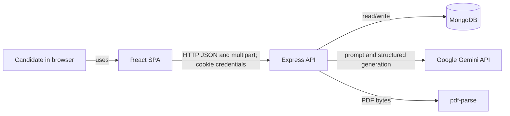
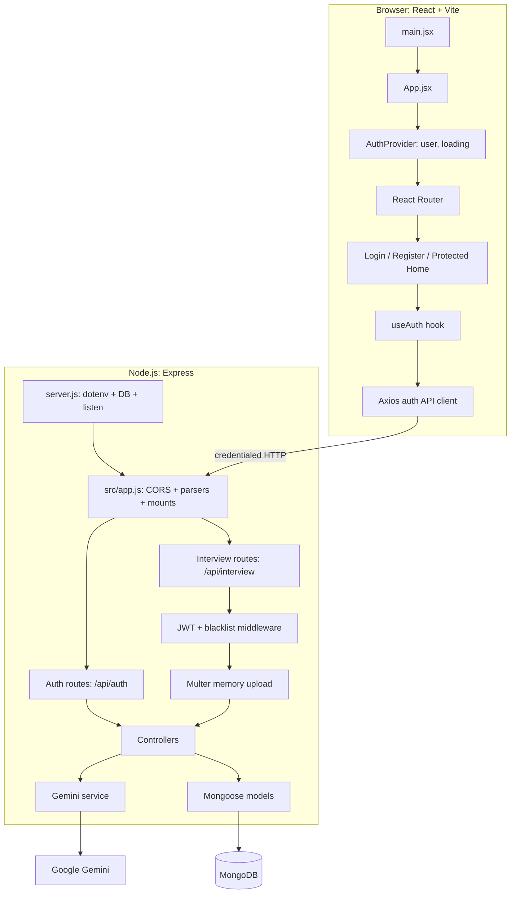
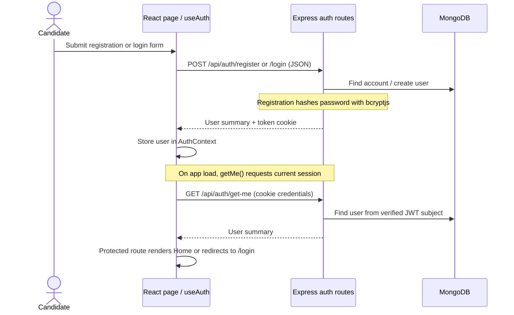
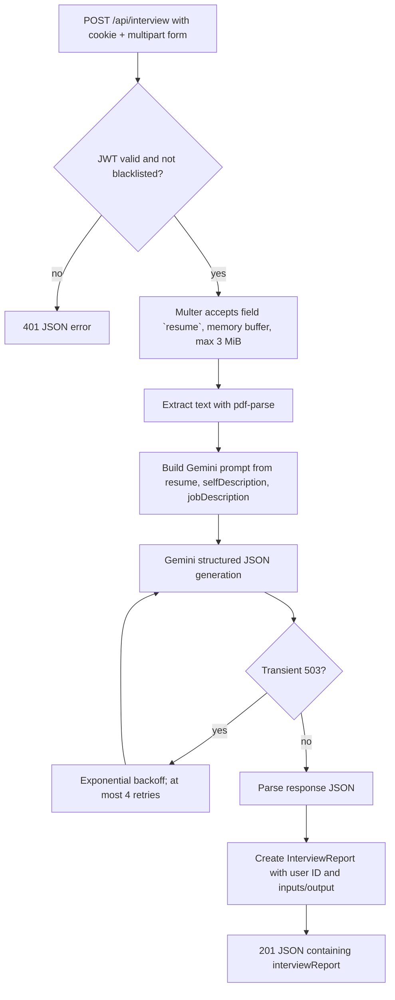
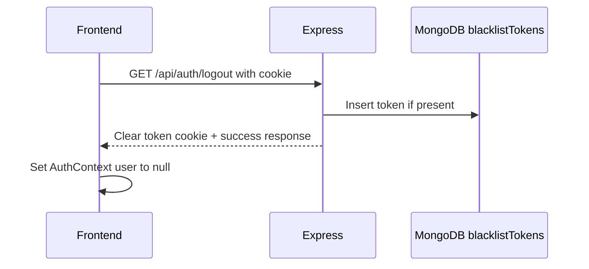
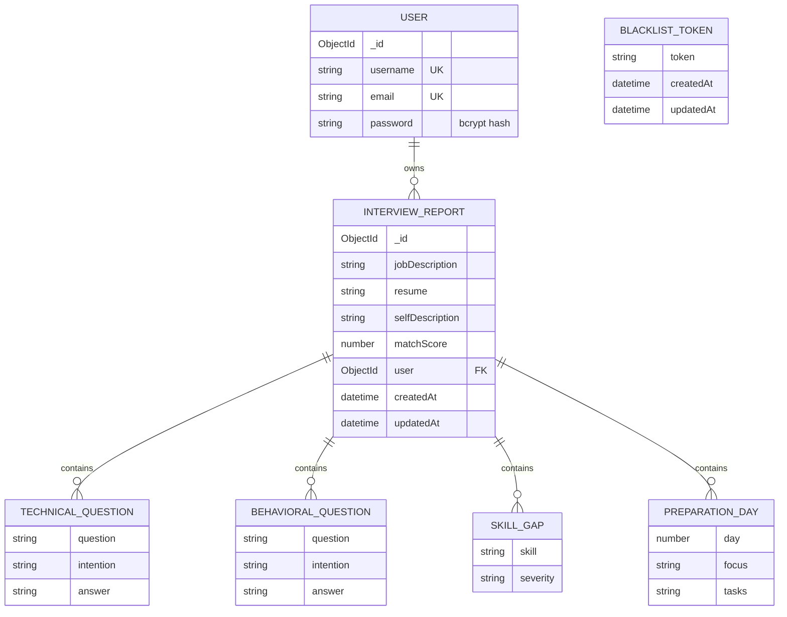

# Architecture and Project Guide

## 1. Product overview

GenAI Resume Builder is a browser-based interview-preparation application. Its intended core workflow combines three inputs—a PDF resume, a candidate self-description, and a job description—to produce a structured report containing a match score, technical and behavioral questions, skill gaps, and a seven-day preparation plan.

The repository contains a React 19/Vite frontend and a Node.js/Express 5 backend. The backend authenticates users with JWTs stored in cookies, extracts text from uploaded PDFs, calls Google's Gemini API for report generation, and stores user/report records in MongoDB via Mongoose.

**Current implementation boundary:** the backend interview-generation endpoint exists, and the frontend home screen shows the input controls. The current home component does not manage their values, upload the PDF, call the endpoint, or display a report. Consequently, the end-to-end AI workflow is available at the API layer but is not yet wired through the UI.

## 2. System context



The frontend is configured for `http://localhost:3000`; the backend CORS policy allows `http://localhost:5173` with credentials. This matches the local Vite/Express development setup. Both values are currently hard-coded.

## 3. Repository and responsibility map

### Backend (`BACKEND/`)

| Path | Responsibility |
| --- | --- |
| `server.js` | Loads `.env`, connects to MongoDB, starts the HTTP server on port 3000. |
| `src/app.js` | Builds the Express app; configures CORS, cookies, JSON parsing, and route mounts. |
| `src/config/database.js` | Opens the Mongoose connection using `MONGO_URI`. |
| `src/routes/auth.routes.js` | Register, login, logout, and current-user routes. |
| `src/routes/interview.routes.js` | Authenticated report generation route with a single uploaded resume. |
| `src/controllers/auth.controller.js` | Registration/login/logout/current-user request handling. |
| `src/controllers/interview.controller.js` | PDF text extraction, AI service invocation, report persistence, response. |
| `src/middlewares/auth.middleware.js` | Cookie token presence, blacklist lookup, JWT verification, `req.user` assignment. |
| `src/middlewares/file.middleware.js` | Multer memory storage with a 3 MiB file-size limit. |
| `src/services/ai.service.js` | Gemini prompt, Zod response shape, transient 503 retry, JSON parsing. |
| `src/models/user.model.js` | User username/email/password hash schema. |
| `src/models/blacklist.model.js` | Persisted revoked-token records. |
| `src/models/interviewReport.model.js` | Interview input and generated-output schema. |
| `src/services/temp.js` | Unreferenced sample resume, self-description, and job-description data. |

### Frontend (`FRONTEND/`)

| Path | Responsibility |
| --- | --- |
| `src/main.jsx` / `src/App.jsx` | React entry point, styles, auth provider, router provider. |
| `src/app.routes.jsx` | `/login`, `/register`, and protected `/` route definitions. |
| `src/features/auth/services/auth.context.jsx` | Shared user and loading state. |
| `src/features/auth/hooks/useAuth.js` | Login/register/logout handlers and session hydration via `getMe`. |
| `src/features/auth/services/auth.api.js` | Axios calls to authentication endpoints with cookie credentials. |
| `src/features/auth/components/Protected.jsx` | Loading state and redirect for unauthenticated users. |
| `src/features/auth/pages/` | Login and registration forms. |
| `src/features/inteview/pages/Home.jsx` | Interview-input presentation (folder is spelled `inteview` in the repository). |
| `src/features/inteview/styles/home.scss` | Home layout styles. |
| `src/style.scss`, `src/style/button.scss` | Global and shared button styling. |

## 4. Runtime architecture



### Request layering

The intended backend request path is **route → middleware → controller → service/model → response**. Authentication is shared middleware. File upload is route middleware for the interview endpoint. The AI service owns prompt/schema concerns; the controller owns orchestration and persistence. There is no separate frontend interview API client in the current source tree.

## 5. Main flows

### 5.1 Authentication and protected page



Registration accepts `username`, `email`, and `password`; login accepts `email` and `password`. Both issue a JWT with a two-day expiry, placing it in a cookie named `token`. `/get-me` is protected and returns the current user without the password. Logout records the cookie token in the blacklist collection and clears the cookie.

### 5.2 Interview report generation (backend API flow)



The endpoint is `POST /api/interview/`. It expects multipart form data with a `resume` PDF file plus text fields `selfDescription` and `jobDescription`. The middleware enforces a 3 MiB file limit and stores bytes in memory. The controller extracts text, calls the AI service, associates the report to `req.user.id`, and returns the saved document. PDF MIME/content validation and required text-field validation are not implemented in the route/controller.

The Gemini prompt requests a 0–100 match score; technical and behavioral questions with rationale and answer guidance; skill gaps with severity; and a seven-day plan. The AI service requests JSON using a Zod-derived schema and retries errors it recognizes as HTTP/status 503 with exponential delays starting at two seconds.

### 5.3 Logout



Logout itself is not behind `authUser`; it can clear a cookie even when there is no token. Blacklist entries have timestamps, but no expiry/cleanup policy is defined in this project.

## 6. HTTP API reference

Backend base URL in the current frontend: `http://localhost:3000`.

| Method | Path | Access | Request | Success |
| --- | --- | --- | --- | --- |
| `POST` | `/api/auth/register` | Public | JSON `{ username, email, password }` | `201`, message and `{ id, username, email }`; sets `token` cookie. |
| `POST` | `/api/auth/login` | Public | JSON `{ email, password }` | `201`, message and user summary; sets `token` cookie. |
| `GET` | `/api/auth/logout` | Public | Cookie if present | `200`, message; blacklists token and clears cookie. |
| `GET` | `/api/auth/get-me` | Cookie/JWT | Cookie `token` | `200`, current user summary. |
| `POST` | `/api/interview/` | Cookie/JWT | Multipart: `resume` file, `selfDescription`, `jobDescription` | `201`, message and persisted `interviewReport`. |

Auth middleware returns `401` when the cookie is missing, blacklisted, invalid, or expired. Registration returns `400` for missing fields or a pre-existing username/email. Login returns `400` for an unknown email or invalid password. Other thrown errors currently have no central Express error handler documented or configured in `app.js`.

## 7. Data model



Mongoose collections are created from models: `users`, `blacklistTokens`, and `InterviewReport` (Mongoose's normal collection-name pluralization applies). User and report association is represented by the report's `user` ObjectId reference. Report timestamps are enabled; user timestamps are not. Question/skill subdocuments disable their own `_id`; preparation-plan entries use the default subdocument ID. The match score is constrained from 0 through 100, and skill severity is one of `low`, `medium`, or `high`.

## 8. AI output contract

The Zod schema used to request Gemini output defines:

- `matchScore`: number from 0 to 100.
- `technicalQuestions[]`: `question`, `intention`, `answer` strings.
- `behaviouralQuestions[]`: same three strings (British spelling in the AI schema).
- `skillGaps[]`: `skill`, severity (`low|medium|high`), and `description`.
- `preparationPlan[]`: exactly seven entries with day 1–7, focus, and string tasks.

The Mongoose report schema instead declares `behavioralQuestions` (American spelling), and its skill-gap subdocument does not declare `description`. The controller spreads the AI object directly into the Mongoose document. Mongoose strict schema behavior therefore means the generated `behaviouralQuestions` and gap descriptions do not match declared persistence fields and may be discarded; the declared `behavioralQuestions` can remain empty. This schema mismatch should be resolved before relying on stored report completeness.

## 9. Frontend state and navigation

- `AuthProvider` starts with `user = null` and `loading = true`.
- `useAuth` calls `getMe()` on mount and settles `loading` after the request.
- `Protected` shows a loading view, redirects missing users to `/login`, and renders its child for authenticated users.
- Login and register pages call the hook and navigate after awaited handler calls.
- The Axios client sets `withCredentials: true`, enabling the browser to send/receive cookies for the cross-origin local API.
- The Home page currently renders a job-description textarea, a PDF file selector, a self-description textarea, and a generate button. No form submit or API request is bound to these controls yet.

## 10. Local setup and configuration

### Prerequisites

- Node.js compatible with the installed Vite and Express dependencies.
- MongoDB instance and connection URI.
- Google Gemini API key.

### Install and run

From the repository root, install dependencies in each app directory:

```bash
cd BACKEND && npm install
cd ../FRONTEND && npm install
```

Create `BACKEND/.env` with:

```dotenv
MONGO_URI=mongodb://127.0.0.1:27017/genai_resume_builder
JWT_SECRET_KEY=replace-with-a-long-random-secret
GOOGLE_GENAI_API_KEY=your-google-genai-api-key
```

Run the API and Vite frontend in separate terminals:

```bash
cd BACKEND && node server.js
cd FRONTEND && npm run dev
```

The backend listens on port `3000`; Vite defaults to `5173`. The frontend package defines `dev`, `build`, `lint`, and `preview` scripts. The backend package currently defines only a placeholder `test` script that exits with an error; no test suite is present. The backend has no declared start/dev scripts.

## 11. Security, reliability, and operational notes

These are observations about the current code, not claims that the behavior has been verified in production:

1. **Cookie settings:** `res.cookie("token", token)` does not set `httpOnly`, `secure`, `sameSite`, or an explicit max age. Logout uses `clearCookie("token")`. Production deployment should configure cookie attributes and matching clear options for the intended origins/deployment topology.
2. **Credential verification:** the login controller assigns `bcrypt.compare(...)` without `await`; this returns a promise, so the password check can be truthy without resolving the comparison. Awaiting the comparison is necessary for correct credential validation.
3. **Frontend errors:** API helper functions catch and only log errors, returning `undefined`; `useAuth` also catches without surfacing errors. Pages navigate after handlers regardless of API success, so failures can appear as successful navigation or be hard to diagnose.
4. **AI/data contract:** the behavioral key spelling and skill-gap description schema differ between AI and persistence contracts, as detailed above.
5. **Input validation:** no server-side validation is apparent for required interview text, PDF content/type, or minimum password/email rules beyond required registration fields and database uniqueness.
6. **Error handling:** no common error middleware is configured. Database connection failure is logged but does not prevent `server.js` from proceeding to `listen`; readiness/health checks are absent.
7. **Privacy and retention:** extracted resume text, self-description, job description, and AI output are stored in report documents. No deletion, retention, or data-export endpoint is implemented.
8. **Configuration:** API URL, allowed CORS origin, and server port are fixed in source; environment-specific deployment configuration is not present.
9. **AI response handling:** the response text is parsed with `JSON.parse`; there is no explicit runtime Zod parse of the returned data before persistence.

## 12. Known scope and next implementation steps

The existing architecture supports authentication and report creation at the backend, but the project is not yet a complete user-facing report-generation product. A natural completion sequence is:

1. Add a frontend interview API client that sends `FormData` with the expected field names and cookie credentials.
2. Make the home controls stateful, validate required fields/file selection, show loading/errors, and submit to `POST /api/interview/`.
3. Add a report view for match score, question sets, gaps, and preparation plan.
4. Align AI and Mongoose field names and persist all intended output fields; validate the model response before save.
5. Fix awaited password comparison, propagate API errors to the UI, and configure secure cookie attributes for deployment.
6. Add centralized error handling and environment-based frontend origin/API URL, server port, upload limits, and operational health/readiness behavior.

## 13. Source of truth

This guide describes the checked-in source layout and behavior. In particular, the interview UI file names use the existing `inteview` spelling, and the architecture guide records the gap between the current input-only page and the implemented report-generation API.
